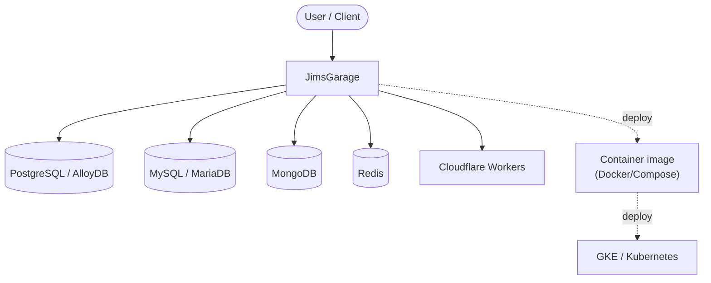

[Discord](https://discord.gg/qW5vEBekz5)  
[Twitter](https://twitter.com/jimsgarage_)  
[Reddit](https://www.reddit.com/user/Jims-Garage)

.png?raw=true)

# Jim's Garage
Here's a collection of Docker Compose and config files for use in my videos. Simply tweak to your environment and deploy!

## Star History

<a href="https://star-history.com/#JamesTurland/JimsGarage&Date">
 <picture>
   <source media="(prefers-color-scheme: dark)" srcset="https://api.star-history.com/svg?repos=JamesTurland/JimsGarage&type=Date&theme=dark" />
   <source media="(prefers-color-scheme: light)" srcset="https://api.star-history.com/svg?repos=JamesTurland/JimsGarage&type=Date" />
   
 </picture>
</a>

<!-- ARCH-DIAGRAM:START -->

## Architecture

> Auto-generated architecture diagram. See [`docs/context-map.md`](docs/context-map.md) for the full context map (core application, containers/cloud, and database connections).

<!-- ARCH-DIAGRAM:END -->
