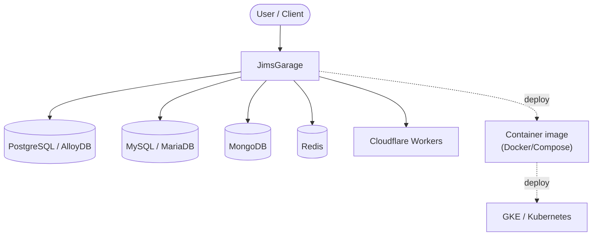

# Context Map — `JimsGarage`

> Auto-generated architecture & deployment context map. Summarizes the core application, container/cloud footprint, and database connections. Regenerate after significant structural changes.

**Repo:** `avnit/JimsGarage` · **Fork** · Public · Primary language: Shell · Default branch: `main` · Files: 440

**Description:** Homelab Goodies

## 1. Core application

[Discord](https://discord.gg/qW5vEBekz5)  

- **Listens on port(s):** 80, 3306, 5000, 5432, 6379, 8080

## 2. Containers & cloud applications

**Containers:**
- `.devcontainer/rke2/Dockerfile`
- `.devcontainer/rke2/devcontainer.json`
- `Ansible/Playbooks/File-Copy/nginx/docker-compose.yaml`
- `Audiobookshelf/docker-compose.yaml`
- `Authelia/Authelia/docker-compose.yaml`
- `Authelia/Nginx/docker-compose.yaml`
- `Authelia/Traefik/docker-compose.yaml`
- `Authentik/docker-compose-traefik.yaml`
- `Authentik/docker-compose.yaml`
- `BunkerWeb/docker-compose.yaml`
- `Caddy/Dockerfile`
- `Caddy/docker-compose.yaml`

**Kubernetes / Helm:**
- `Home-Assistant/Kubernetes/default-headers.yaml`
- `Home-Assistant/Kubernetes/homeassistant-deployment.yaml`
- `Home-Assistant/Kubernetes/ingress.yaml`
- `Home-Assistant/Kubernetes/sealed-secret.yaml`
- `Home-Assistant/Kubernetes/secret.yaml`
- `Jellyfin/Kubernetes/default-headers.yaml`
- `Jellyfin/Kubernetes/ingress.yaml`
- `Jellyfin/Kubernetes/jellyfin-deployment.yaml`
- `Jellyfin/Kubernetes/networkpolicy.yaml`
- `Jellyfin/Kubernetes/pv-smb.yaml`

**Cloud deploy / serverless manifests:**
- `Kubernetes/Traefik-External-Service/service.yaml`
- `Mosquitto/Kubernetes/service.yaml`

**Infrastructure as Code:**
- `Ansible/Playbooks/Docker-Portainer/inventory.yaml`
- `Ansible/Playbooks/Docker-Portainer/playbook.yaml`
- `Ansible/Playbooks/Docker-Portainer/roles/docker_install/handlers/main.yaml`
- `Ansible/Playbooks/Docker-Portainer/roles/docker_install/tasks/main.yaml`
- `Ansible/Playbooks/Docker-Portainer/roles/docker_install/vars/main.yaml`
- `Ansible/Playbooks/Docker-Portainer/roles/portainer_deploy/handlers/main.yaml`
- `Ansible/Playbooks/Docker-Portainer/roles/portainer_deploy/tasks/main.yaml`
- `Ansible/Playbooks/Docker-Portainer/roles/portainer_deploy/vars/main.yaml`
- `Ansible/Playbooks/Docker-Swarm/ansible.cfg`
- `Ansible/Playbooks/Docker-Swarm/collections/requirements.yaml`

**Detected cloud platforms / services:** GKE / Kubernetes, Cloudflare Workers, Ansible

## 3. Database connections

**Datastores in use:** PostgreSQL / AlloyDB, MySQL / MariaDB, MongoDB, Redis, SQLite, InfluxDB

**Referenced in:**
- `Authelia/Authelia/configuration.yml`
- `BunkerWeb/docker-compose.yaml`
- `Checkmate/docker-compose.yaml`
- `Grafana-Monitoring/docker-compose.yaml`
- `Headscale/config.yaml`
- `Home-Assistant/configuration.yaml`
- `Linkwarden/docker-compose.yaml`
- `Paperless-ngx/docker-compose.yaml`
- `Postiz/docker-compose.yaml`
- `SafeLine/docker-compose.yaml`

**Environment / config files:** `Authentik/.env`, `Authentik/Web-Proxies/.env`, `Caddy/.env`, `Guacamole/.env`, `Hoarder/.env`, `Immich/.env`, `Jitsi/.env`, `Komodo/.env`

> ⚠️ Non-template env files are committed: `Authentik/.env`, `Authentik/Web-Proxies/.env`, `Caddy/.env`, `Guacamole/.env`, `Hoarder/.env`, `Immich/.env`. Verify no live secrets are tracked.

## 4. Architecture diagram

## 5. Security posture

- **Static scan findings:** 8 critical, 20 high, 13 medium, 2 low

| Severity | Rule | File:Line |
|---|---|---|
| critical | private-key-block | `Authelia/Authelia/configuration.yml:369` |
| critical | private-key-block | `Authelia/Authelia/configuration.yml:790` |
| critical | private-key-block | `Authelia/Authelia/configuration.yml:962` |
| critical | private-key-block | `Authelia/Authelia/configuration.yml:1068` |
| critical | private-key-block | `Authelia/Authelia/configuration.yml:1225` |
| critical | private-key-block | `Authelia/Authelia/configuration.yml:1314` |
| critical | db-url-with-password | `Home-Assistant/configuration.yaml:128` |
| critical | db-url-with-password | `Postiz/docker-compose.yaml:18` |

---
_Generated by repo context-mapping pass on 2026-08-13._